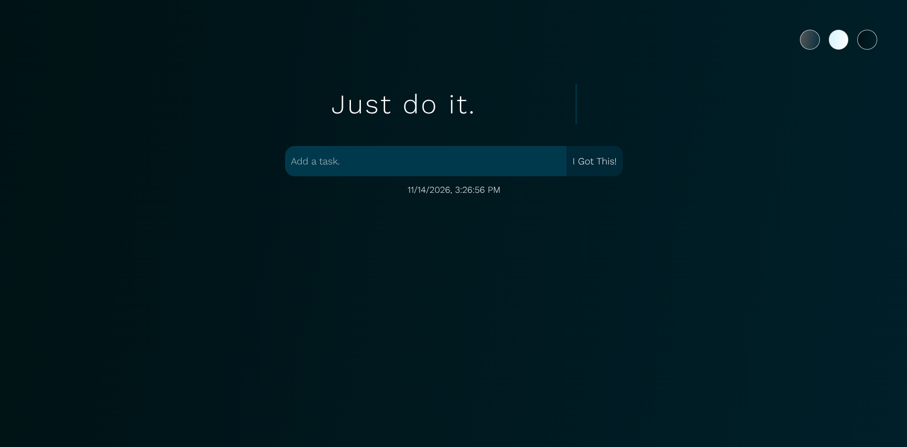

# Just Do It — Todo List

A focused, browser-based task manager with a typewriter-style header, smooth delete animations, and three visual themes. Tasks and your theme choice stay on your device—no account, no backend.

Inspired by the clean UX of [tusharnankani/ToDoList](https://github.com/tusharnankani/ToDoList), rebuilt with **React** and **Vite** as a small, component-driven app you can run locally or deploy as static files.



## Features

- **Add tasks** — type a task and hit **I Got This!** (empty input shows a quick alert, same spirit as the original app).
- **Mark complete** — strikethrough and faded style when done.
- **Delete with animation** — items fall off the list before they’re removed.
- **Three themes** — Standard (default gradient), Light, and Darker; your pick is remembered.
- **Live clock** — current date and time under the form.
- **Persistent storage** — todos and theme saved in `localStorage` so a refresh doesn’t wipe your list.
- **Responsive layout** — usable on smaller screens (stacked form on narrow viewports).

## Tech stack

| Layer        | Choice                          |
| ------------ | ------------------------------- |
| UI           | React 19                        |
| Build        | Vite 8                          |
| Styling      | Custom CSS + Tailwind 4 (`@import "tailwindcss")` |
| Icons        | Font Awesome 5 (CDN)            |
| Font         | Work Sans (Google Fonts)        |
| Data         | Browser `localStorage` only     |

No API, no database, no auth—everything runs in the client.

## Quick start

**Requirements:** Node.js 18+ (20+ recommended)

```bash
git clone <your-repo-url>
cd "TODO LIST"

npm install
npm run dev
```

Open the URL Vite prints (usually `http://localhost:5173`).

### Other scripts

```bash
npm run build    # production bundle → dist/
npm run preview  # serve the production build locally
npm run lint     # ESLint
```

## Project structure

```
src/
├── App.jsx                 # State: todos, theme, form input
├── main.jsx                # Mount + initial theme on <body>
├── index.css               # Themes, animations, layout
├── utils/
│   └── storage.js          # localStorage helpers
└── components/
    ├── Header.jsx          # Title + theme controls
    ├── ThemePicker.jsx     # Three theme dots
    ├── TodoForm.jsx        # Input + submit
    ├── TodoList.jsx        # List wrapper
    ├── TodoItem.jsx        # Single task + check/delete + fall animation
    └── Clock.jsx           # Live datetime
```

## How persistence works

| Key            | Content                                      |
| -------------- | -------------------------------------------- |
| `savedTheme`   | `"standard"` \| `"light"` \| `"darker"`      |
| `todos`        | JSON array of task strings, e.g. `["Buy milk","Code"]` |

Completed state is **not** written to `localStorage` (same behavior as the vanilla reference app)—after reload, tasks come back unchecked.

## Deployment

After `npm run build`, upload the contents of `dist/` to any static host (GitHub Pages, Netlify, Vercel, Cloudflare Pages, etc.). No server env vars required.

## License

This project is yours to license as you prefer. The original [ToDoList](https://github.com/tusharnankani/ToDoList) design inspiration is credited above.

## Author

**Emranullah Rasoli** — contributions and issues welcome via GitHub.